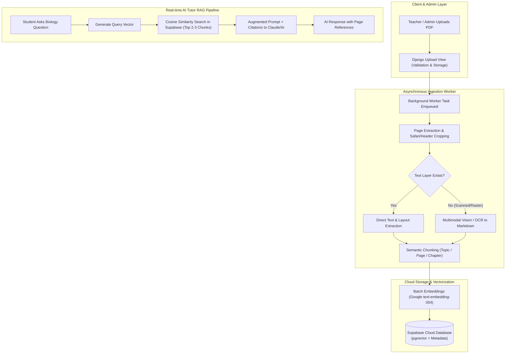

# PDF Content Ingestion & RAG Roadmap for reanBio

## 1. Executive Summary
This document outlines the architecture, technology stack, and phased implementation plan for adding an automated **PDF Document Upload and Knowledge Ingestion System** to the **reanBio** biology e-learning platform.

The system will enable teachers and administrators to upload curriculum textbooks, lecture slides, and reference materials in PDF format. The system automatically processes the files, extracts and structures the content (handling both digital and scanned/raster PDFs), stores vector embeddings in a free cloud database, and empowers the platform's AI Tutor with high-precision, token-efficient **Retrieval-Augmented Generation (RAG)**.

---

## 2. Technical Stack

| Layer | Technology | Rationale / Highlights |
| :--- | :--- | :--- |
| **Web Framework** | **Django 6.0** (Python 3.14) | Existing project backend; handles routing, authentication, and file storage. |
| **PDF & Image Processing** | **PyMuPDF (`fitz`) & Pillow** | High-performance PDF rendering, metadata extraction, page splitting, and header/footer cropping. |
| **OCR & Vision Extraction** | **Claude 3.5 / Haiku Vision** or **Gemini Flash Vision** *(Fallback: Tesseract / Apple Vision)* | Necessary because educational PDFs (such as flipbooks saved from Safari) are often raster images without text layers. Vision models convert scanned pages directly into clean Markdown (tables, diagrams, structured headers). |
| **Embedding Model** | **Google `text-embedding-004`** | **100% Free tier** via Google AI Studio, 768 dimensions, native support for Thai and English scientific terms. |
| **Cloud Vector Database** | **Supabase (`pgvector`)** | **Free tier (500 MB)** PostgreSQL database with native vector similarity search (`cosine distance`). Keeps structured metadata (chapter, topic, page number) together with vectors. |
| **Asynchronous Task Queue** | **Celery + Redis** *(or Django-Q2)* | Offloads long-running PDF extraction (200+ pages) from the main web server process to prevent HTTP timeouts. |

---

## 3. High-Level Architecture & Workflow



---

## 4. Phase-by-Phase Implementation Plan

### Phase 1: Upload Interface & Storage Foundation
* **Tasks:**
  1. Create a dedicated upload UI in the Teacher/Admin dashboard for submitting PDF course materials.
  2. Implement file validation: file size limit (e.g., max 300MB), MIME type checking, and anti-virus scanning.
  3. Store raw PDF files in `media/documents/` and track processing state using a new Django model (`DocumentUpload`).
* **Deliverables:** Working file upload form with progress status (`PENDING`, `PROCESSING`, `COMPLETED`, `FAILED`).

### Phase 2: Asynchronous Preprocessing & OCR Pipeline
* **Tasks:**
  1. Integrate background task worker to process PDFs asynchronously.
  2. Implement a pre-processing module using `PyMuPDF`:
     * Crop top and bottom margins (removes web browser headers, URLs, and footers).
     * Detect whether the page contains selectable text or raster images.
  3. Integrate the OCR/Vision service:
     * For scanned pages, send compressed page images to Vision LLM / OCR API.
     * Output structured Markdown preserving biology terms, lists, and tables.
* **Deliverables:** Standardized Markdown output and page-by-page JSON artifacts for each processed document.

### Phase 3: Semantic Chunking & Vector Ingestion (Supabase)
* **Tasks:**
  1. Provision a free Supabase instance and activate the `pgvector` extension.
  2. Implement a semantic chunking utility:
     * Chunk size: 300 – 600 words (~1,000 – 2,000 characters).
     * Overlap: 10% (preserve cross-sentence context).
     * Attach metadata: `book_title`, `chapter`, `topic`, `page_number`, `source_filename`.
  3. Integrate Google `text-embedding-004` to generate 768-dimensional embeddings in batches.
  4. Upsert chunks and vectors into the Supabase `bio_knowledge` table.
* **Deliverables:** Automated vector ingestion pipeline connecting processed PDFs to Supabase Cloud.

### Phase 4: AI Tutor Integration & Token Optimization
* **Tasks:**
  1. Update `reanBio/ai_helper.py` to replace mock RAG lookups with Supabase vector similarity queries.
  2. Restrict retrieval to **Top 2–3 most relevant chunks** to keep token usage below 1,000 tokens per request.
  3. Enable **Anthropic Prompt Caching** for static system prompts and frequent reference topics (reduces costs up to 90%).
  4. Include citation badges in the chat response (e.g., *"Reference: Biology Grade 10, Chapter 1, Page 45"*).
* **Deliverables:** Live AI Tutor answering student queries based strictly on the ingested PDF content.

---

## 5. Proposed Database Schema (Supabase / PostgreSQL)

```sql
-- Enable vector extension
create extension if not exists vector;

-- Document tracking table
create table document_uploads (
    id bigserial primary key,
    title text not null,
    subject text default 'Biology',
    grade_level text,              -- e.g., 'Grade 10 (ม.4)'
    filename text not null,
    total_pages int,
    status text default 'PENDING', -- PENDING, PROCESSING, COMPLETED, FAILED
    created_at timestamp with time zone default now()
);

-- Vector knowledge chunks
create table bio_knowledge (
    id bigserial primary key,
    document_id bigint references document_uploads(id) on delete cascade,
    book_title text not null,
    chapter text,
    topic text,
    page_number int,
    content text not null,
    token_count int,
    embedding vector(768),
    created_at timestamp with time zone default now()
);

-- Cosine distance similarity search function
create or replace function match_bio_knowledge (
  query_embedding vector(768),
  match_threshold float default 0.65,
  match_count int default 3
)
returns table (
  id bigint,
  book_title text,
  chapter text,
  topic text,
  page_number int,
  content text,
  similarity float
)
language sql stable
as $$
  select
    id,
    book_title,
    chapter,
    topic,
    page_number,
    content,
    1 - (bio_knowledge.embedding <=> query_embedding) as similarity
  from bio_knowledge
  where 1 - (bio_knowledge.embedding <=> query_embedding) > match_threshold
  order by similarity desc
  limit match_count;
$$;
```

---

## 6. Success Metrics & Budget
* **Cost:** $0 / month (Supabase 500MB Free Tier + Google Embedding Free Tier).
* **Ingestion Accuracy:** >95% retrieval accuracy on core high school biology questions.
* **Token Efficiency:** <1,500 total tokens per AI query (including conversation history and retrieved context).
* **Processing Speed:** <3 seconds retrieval response time from Supabase Cloud.
